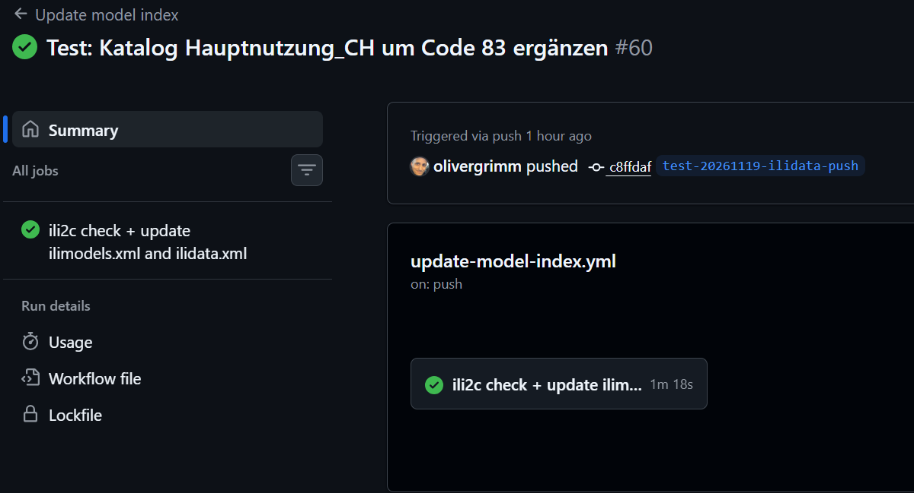

# modelrepo_sh_public

Dieses Repository ist der Quellstand für das öffentliche INTERLIS-Modell-Repository des Kantons Schaffhausen ([models.geo.sh.ch](https://models.geo.sh.ch/)). Änderungen an Modellen (`*.ili`) oder Katalogen/Daten (`*.xml`) werden hier über Pull Requests eingebracht, automatisiert geprüft und bei jedem Merge nach `main` als GitHub Release veröffentlicht.

## Ordnerstruktur

```
repository/              1:1-Spiegel von https://models.geo.sh.ch/
├── ilimodels.xml        Index aller Modelle (von ilimanager gepflegt)
├── ilidata.xml          Index der Kataloge/Daten (von ilivalidator ergänzt)
├── ilisite.xml          Standort-Metadaten (Name, Titel, Kontakt – manuell gepflegt)
├── AGI/                 Amt für Geoinformation (u.a. amtliche Vermessung, OeREB)
├── FA/                  Forst (Waldfunktionsplanung, Waldreservate)
├── IKL/                 Interkantonales Labor (Versickerungsbereiche, Risikokarte, Abfallanlagen)
├── JF/                  Jagd und Fischerei (Jagdreviere)
├── LA/                  Landwirtschaft (Melioration, landwirtschaftliche Eignung)
├── PNA/                 Planungs- und Naturschutzamt (Nutzungsplanung, Richtplan, Naturschutz)
├── TSH/                 Tiefbau (Strassenrichtplan, Naturgefahrenkarte, Gewässer)
└── _modelldokumentationen/   PDF-Dokumentationen, Struktur spiegelt obige Ordner

.github/
├── workflows/           GitHub Actions (siehe unten)
└── scripts/              Von den Workflows aufgerufene Shell-Scripts
```

Jeder Themenordner kann einen Unterordner `replaced/` enthalten – dort liegen abgelöste, aber aus Kompatibilitätsgründen weiter referenzierbare Modellversionen.

**Wichtig:** `repository/` ist ein byte-exakter Spiegel der publizierten Dateien. Die in `ilimodels.xml`/`ilidata.xml` hinterlegten md5-Prüfsummen beziehen sich auf die Original-Bytes – siehe `.gitattributes` weiter unten.

## GitHub Actions

| Workflow | Trigger | Zweck |
|---|---|---|
| **validate-models.yml** | Push/PR auf `main` | Zwei Required-Status-Checks: `ili2c --check-repo-ilis` (kompiliert alle Modelle aus `ilimodels.xml`) und `ilimanager index freshness` (regeneriert `ilimodels.xml` und `ilidata.xml` zum Abgleich, prüft `ilidata.xml` auf tote Pfade) |
| **update-model-index.yml** | Push auf Arbeits-Branches (nicht `main`), bei geänderten `*.ili`/`*.xml` | Aktualisiert `ilimodels.xml` automatisch (via ilimanager) und validiert den gesamten Stand mit ili2c. Neue oder gegenüber `main` geänderte Kataloge/Daten (`*.xml`) werden mit `ilivalidator` gegen ihr Modell geprüft und in `ilidata.xml` eingetragen (neuer Eintrag bzw. neue Dataset-Version, nur wenn der md5 noch nicht indexiert ist). Beide Indexdateien landen in einem einzigen Bot-Commit |
| **release.yml** | Push auf `main` | Re-validiert den finalen Stand mit allen drei Tools, baut `repository/` als ZIP (`models.geo.sh.ch_YYYYMMDDHHmm.ZIP`) und veröffentlicht ZIP + Tool-Logs + Datei-Changelog als GitHub Release |

Alle Tool-Versionen (ili2c, ilimanager, ilivalidator) sind in den jeweiligen Workflows als `env:`-Variablen gepinnt und werden bei Bedarf von downloads.interlis.ch heruntergeladen und gecacht.

Kernbefehle (Tool-Jar jeweils per `java -jar ...` aufgerufen):

```sh
# ili2c: kompiliert alle in ilimodels.xml referenzierten Modelle
java -jar ili2c.jar --check-repo-ilis repository

# ilimanager: regeneriert ilimodels.xml aus dem aktuellen Dateistand (in place)
java -jar ilimanager.jar --updateIliModels --repos repository --out repository/ilimodels.xml
```

### Scripts (`.github/scripts/`)

| Script | Verwendet von | Zweck |
|---|---|---|
| `check-ilimodels-index.sh` | validate-models.yml | Prüft, ob `ilimodels.xml` dem aktuellen Dateistand entspricht (ordnungsunabhängiger Vergleich) |
| `check-ilidata-paths.sh` | validate-models.yml | Prüft, ob alle `<path>`-Einträge in `ilidata.xml` auf existierende Dateien zeigen |
| `validate-new-data-files.sh` | update-model-index.yml, release.yml | Validiert gegebene Dateien mit ilivalidator |
| `add-ilidata-entries.sh` | update-model-index.yml | Ergänzt `ilidata.xml` um Einträge für neue Dateien (überspringt bereits indexierte Pfade) |
| `update-ilidata-entries.sh` | update-model-index.yml | Hängt für geänderte Dateien eine neue Dataset-Version an `ilidata.xml` an (überspringt, wenn der md5 schon in der neuesten Version steht) |
| `release-validation-logs.sh` | release.yml | Führt ili2c/ilimanager/ilivalidator erneut aus und schreibt ihre Logs nach `/tmp/release-logs/` |
| `generate-changelog.sh` | release.yml | Erstellt die Markdown-Changelog-Sektion der Release-Notes aus dem Datei-Diff zum letzten Release |

## Wichtige Konfigurationen

- **Branch Protection auf `main`:** Pull Request zwingend erforderlich (kein direkter Push), Required Status Checks `ili2c --check-repo-ilis` und `ilimanager index freshness`, keine Umgehung durch Admins.
- **`.gitattributes`:** `repository/** -text` – verhindert, dass Git die Zeilenenden der gespiegelten Dateien verändert (sonst würden die md5-Prüfsummen in `ilimodels.xml`/`ilidata.xml` nicht mehr stimmen, je nach Betriebssystem des Checkouts).
- **Bot-Commits ohne `[skip ci]`:** Die automatischen Commits von `update-model-index.yml` enthalten bewusst **kein** `[skip ci]` – das würde auch `validate-models.yml` für diesen Commit unterdrücken, wodurch ein PR dauerhaft auf „Waiting for status to be reported" hängen bliebe. Der Bot-Commit ändert nur `ilimodels.xml`/`ilidata.xml`, die vom Trigger ausgenommen sind, und startet den Workflow deshalb nicht erneut. Ein erneuter Durchlauf bei einem späteren Push ist ungefährlich, da die Schritte idempotent sind (bereits indexierte Pfade bzw. md5-Werte werden übersprungen).


## Anwendungsdokumentation

### Zweck und Zielgruppe

Modelle (`*.ili`) und Kataloge (`*.xml`) des Kantons Schaffhausen werden nur noch über einen Pull Request geändert; die Indexdateien pflegt die Automation. Diese Schulung zeigt den Ablauf an einem konkreten Beispiel.

Sie richtet sich an Mitarbeitende, die Modelle oder Kataloge anpassen. 
Das INTERLIS-Repository ist der Quellstand für [models.geo.sh.ch](https://models.geo.sh.ch/).

### Überblick: Repository und Automation

Der Ordner `repository/` ist ein byte-genauer Spiegel des öffentlichen Modell-Repositories. Zwei Indexdateien darin dürfen Sie nicht von Hand ändern, weil sie von der Automation gepflegt werden.

| Datei / Ordner | Inhalt | Gepflegt von |
| --- | --- | --- |
| `ilimodels.xml` | Index aller Modelle (`*.ili`) | ilimanager (Bot) |
| `ilidata.xml` | Index der Kataloge und Daten (`*.xml`), je Datei mit Version und md5 | ilivalidator (Bot) |
| `ilisite.xml` | Standort-Metadaten | manuell |
| `PNA/`, `AGI/`, `LA/` … | Modelle und Kataloge je Amt | Sie |
| `<Amt>/replaced/` | abgelöste Modellversionen, die weiter referenzierbar bleiben müssen | Sie |

Zwei Workflows laufen automatisch:

| Workflow | Wann | Was passiert |
| --- | --- | --- |
| Update model index | Push auf einen Arbeits-Branch, bei geänderten `*.ili` oder `*.xml`; die Indexdateien selbst lösen ihn nicht aus | `ilimanager` aktualisiert `ilimodels.xml`, `ili2c` kompiliert alle Modelle, `ilivalidator` prüft neue oder gegenüber `main` geänderte Kataloge, und `ilidata.xml` wird ergänzt. Bei Erfolg folgt ein einziger Bot-Commit »Update ilimodels.xml and ilidata.xml« |
| Validate INTERLIS models | Pull Request und Push auf `main` | Pflichtchecks `ili2c --check-repo-ilis` und `ilimanager index freshness`; ohne grünen Status ist der Merge gesperrt |

Nach dem Merge baut ein dritter Workflow (`release.yml`) das ZIP des Repositories als GitHub Release.

### Ablauf Schritt für Schritt

Eine Anpassung erfolgt in sechs Schritten. Schritt 4 läuft automatisch.

1. **Aktuellen Stand holen.** In Visual Studio Code auf `main` wechseln und pullen. Ohne diesen Schritt fehlen Ihnen spätere Korrekturen an der Automation.
2. **Branch anlegen.** Neuen Branch mit sprechendem Namen erstellen, zum Beispiel `Modellanpassungen-092026-PNA-Schutzinstrumente`. Unten links prüfen, dass der neue Branch aktiv ist.
3. **Änderung durchführen, committen und pushen.** Modell oder Katalog anpassen. Bei einer neuen Hauptversion eines Modells die bisherige Datei zuerst in den Ordner `replaced/` des Amtes verschieben und die neue Version als neue Datei ablegen.
Die Änderungen anschliessend committen und pushen.
4. **Automatik auf dem Branch: Modell- und Katalogindex.** Nach dem Push läuft »Update model index«: 
   * `ilimodels.xml` wird aktualisiert, alle Modelle werden mit `ili2c` kompiliert.
   * neue oder geänderte Kataloge werden mit `ilivalidator` geprüft und in `ilidata.xml` eingetragen. 
Bei Erfolg erscheint ein einziger Bot-Commit »Update ilimodels.xml and ilidata.xml« welcher die beiden neuen Dateien enthält. Vergesse nicht, diese Dateien lokal zu pullen, da sie auf dem Server erstellt wurden.



Nach diesem Schritt umfasst der Change auch die angepassten Index-Files (ilimodels.xml / ilidata.xml)

1. **Pull Request erstellen und prüfen.** Die Pflichtchecks müssen grün sein (rund 100 Sekunden). Bis dahin ist der Merge gesperrt.
2. **Mergen und Branch löschen.** Danach erzeugt der Release-Workflow das ZIP unter https://github.com/agiktsh/modelrepo_sh_public/releases; dessen Inhalt veröffentlicht man manuell auf [models.geo.sh.ch](https://models.geo.sh.ch/).
